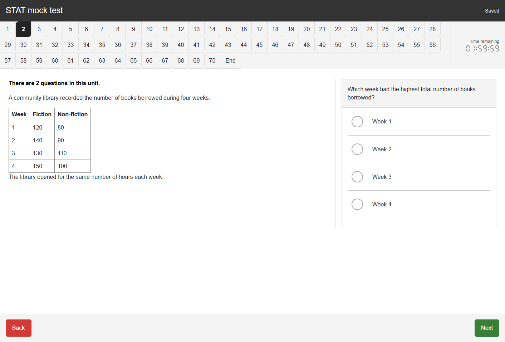
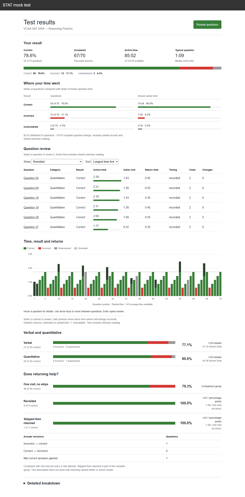

# STAT Practice

A free, local STAT practice app built to closely match the real exam interface as of **25 October 2026**: shared reading material beside the question, A–D answer choices, numbered navigation, a countdown and familiar Back/Next controls.

Open source and independent; not affiliated with ACER or an admissions authority.



*Captured from a local GAT 2004 sitting. The public screenshot uses original sample question content in place of third-party material; the test interface is unchanged.*

## After the test

Review more than a score: accuracy by reasoning category, time per question and shared stimulus, revisits, skips, answer changes and autosaved notes. The question chart connects time spent with results and return visits; filters help you find mistakes and slow questions.

<details>
<summary>See an example statistics report</summary>



*Illustrative results generated in a disposable database. These are synthetic records, not a learner's attempt. Practice statistics do not predict a STAT scaled score.*

</details>

## Get started

Requires Python 3.10 or later. Download or clone this repository, then run:

```sh
python -m venv .venv
```

Activate with `.venv\Scripts\Activate.ps1` in Windows PowerShell, or `source .venv/bin/activate` on macOS/Linux. Then:

```sh
python -m pip install -r requirements.txt
python -m uvicorn app:app --host 127.0.0.1 --port 8000
```

Open [localhost:8000](http://127.0.0.1:8000). On Windows, you can also double-click `START_MOCK.cmd` to install dependencies and start the app. Keep its window open while practising.

Choose **Demo test** for a five-minute walkthrough with four original questions.

## Import a practice paper

Third-party papers are not bundled because redistribution rights have not been cleared. The [source catalogue](MOCK_SOURCES.md) links GAT, AST, TSA, BMAT and SAT papers, with answer keys and conversion notes.

Open this repository in your coding agent and ask:

> Read `skills/import-mock/SKILL.md` and import GAT 2011 from `MOCK_SOURCES.md` for local practice.

You can also provide your own paper and answer-key links. The [import skill](skills/import-mock/SKILL.md) converts the paper in one agent pass and checks structure, assets, timing, answer saving and grading. It requires no subagents. Read [Validation](VALIDATION.md) for what those checks cover.

The skill works as a Markdown instruction file; no installation is required. Agents that support skill discovery can install the `skills/import-mock/` folder using their usual convention. PDF conversion may require PyMuPDF. Importing may incur your agent provider's normal charges; running the app itself is free.

## Practise and review

Answers save locally and unfinished tests resume in the same browser. The timer tracks active practice time and pauses when the page is hidden. After submission, review answers, timing, visits and notes. Scores describe practice performance; they do not predict a STAT scaled score.

Run the app on your own computer at `127.0.0.1`. It supports one user and is not configured for public hosting. Attempts and exports are stored in `data/`; back up that folder with the server stopped. Keep both it and browser storage intact during an unfinished test.

## Contribute

See [Contributing](CONTRIBUTING.md) for development and bug reports, [Content policy](CONTENT_POLICY.md) for sharing question packs, and [Security](SECURITY.md) for privacy guidance. The code, documentation and original demo questions use the [MIT licence](LICENSE).
